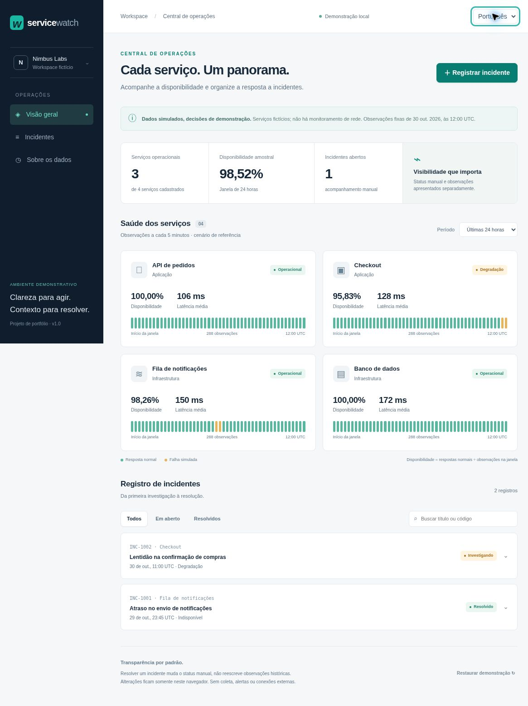

# Service Watch

Central de operações demonstrativa para serviços fictícios. Projeto de portfólio independente, sem clientes ou sistemas reais envolvidos.

## Problema e solução
Uma equipe precisa distinguir o estado atual de um serviço, sua disponibilidade histórica e a evolução de um incidente. O painel separa essas informações e oferece registros com linha do tempo, filtros e validação de transições.

## Executar
Requer Node.js 20+ somente para testes. A aplicação não precisa de instalação, compilação ou dependências de terceiros.

```sh
npm test
npm run check
python3 -m http.server 8080 --directory dist
# Abra http://localhost:8080
```
Sirva por HTTP: módulos JavaScript não são suportados de modo consistente em `file://`.

## Recursos
- Interface responsiva em português, inglês e japonês, com preferência persistida.
- Quatro serviços fictícios e 1.152 observações simuladas determinísticas.
- Janelas de 1, 6 e 24 horas; disponibilidade amostral e média de latência.
- Criação, atualização e resolução de incidentes; histórico, filtros e busca.
- Validação de entradas, prevenção de incidente ativo duplicado e histórico de resolvidos imutável.
- Persistência local versionada, recuperação de dados inválidos e aviso de falha de armazenamento.
- Restauração de demonstração com confirmação; diálogos canceláveis por botão ou Escape.

## Arquitetura
- `dist/domain.js`: funções puras para dados, validação, métricas e ciclo de incidentes.
- `dist/i18n.js`: textos PT/EN/JA e formatação estática. Conteúdo escrito pelo visitante não é traduzido automaticamente.
- `dist/app.js`: apresentação, eventos, persistência e formatação por localidade.
- `dist/style.css`: layout responsivo sem bibliotecas.
- `tests/domain.test.js`: testes de domínio com o runner nativo do Node.
- `tests/frontend.test.js`: controladores e fluxos com adaptador DOM leve (não substitui teste visual).
- `docs/QA.md`: escopo da verificação e limitações.

## Regras e honestidade dos dados
A referência é **30/10/2026, 12:00 UTC**, não o relógio atual. As 288 amostras por serviço representam as últimas 24 horas, a cada 5 minutos. A janela usa o intervalo `(referência − duração, referência]`. Disponibilidade é a fração de amostras normais; **não é um SLA nem disponibilidade contínua medida**. A média de latência considera apenas respostas normais. Sem amostras, as métricas são nulas. Cada bloco visual agrega amostras e marca falha se qualquer amostra do bloco falhar; as métricas são calculadas nas amostras originais.

O status manual é derivado de incidentes abertos: indisponibilidade tem prioridade sobre degradação. Resolver um incidente não altera as observações. Novos registros usam a hora atual ou a referência, o que for posterior, para evitar datas anteriores ao cenário. Todos os horários são apresentados em UTC. Dados iniciais são traduzidos; textos inseridos pelo usuário permanecem intactos.

## Limitações e evolução para produção
**Não há sondagem de URLs, monitoramento real, alertas, autenticação, backend ou compartilhamento entre dispositivos.** Não inserir dados sensíveis: localStorage não é um cofre. Outra aba pode sobrescrever alterações; não há sincronização concorrente. O histórico local não constitui trilha de auditoria inviolável.

Uma versão de produção precisaria de coletor backend agendado, lista explícita de destinos autorizados e proteção contra SSRF, timeouts e limites de taxa. Persistência transacional, autorização, auditoria no servidor, retenção, agregação de métricas e entrega de alertas seriam módulos separados. Credenciais nunca devem ir para o frontend. A interface poderia consumir uma API validada sem alterar as funções puras de cálculo. Nada disso está implementado nesta demonstração.

## English
A standalone portfolio demo for fictional service status and incident response. Run `npm test`, `npm run check`, then serve `dist/` over HTTP. Choose English in the header. Includes deterministic sampled availability, incident timelines, validation and local browser storage. No real monitoring, network probes, alerts, authentication or backend. All dates are UTC. User-entered content is preserved in its original language.

## 日本語
架空のサービスを対象とした、稼働状況・インシデント管理のポートフォリオ作品です。`npm test` と `npm run check` を実行し、`dist/` を HTTP サーバーで配信してください。ヘッダーから日本語を選択できます。固定の観測データ、経過記録、入力検証、ブラウザー内保存に対応しています。実際の監視・外部へのアクセス・通知・認証・バックエンドはありません。時刻はすべて UTC 表記です。入力した文章は自動翻訳されません。

## Captura de tela / Screenshot / 画面


